# Infosys SP / DSE OA — 2-Day Plan (target: solve 2 of 4)

**Sources:** your 3 PDFs (candidate reports from LeetCode Discuss, Naukri Code360, Glassdoor, 2021–2026) + a web search. The search returned no Reddit threads, so nothing here is quoted from Reddit.
**Format reported:** 4 questions in 180 min (Easy, Medium, Hard, Complex). Solving 1 gives System Engineer, 2 gives DSE, 3–4 gives SP. **Your goal of 2 = DSE.**
**Strategy:** Q1 (Easy) is a guaranteed solve. Then pick the ONE medium that matches a pattern below. Never start the Hard/Complex before both are green.

---

## 0. Exam-day setup (do this before anything)

The real OA is **stdin/stdout contest style**, not `class Solution`. Paste this skeleton and put the solution in `solve`:

```python
import sys
sys.setrecursionlimit(10**6)          # top-down needs this (default 1000 dies)

def solve(nums):
    ...

def main():
    data = sys.stdin.read().split()
    n = int(data[0])
    nums = list(map(int, data[1:1 + n]))
    print(solve(nums))

main()
```

If recursion depth could reach ~1e5, wrap it in a thread (stops the stack overflow crash):

```python
import threading
threading.stack_size(1 << 27)
threading.Thread(target=main).start()
```

Rules of thumb: N ≤ 20 → bitmask / backtracking. N ≤ 1000 → O(N²) DP. N ≤ 1e5 → greedy / O(N log N) / O(N). Counting answers usually say `% (10**9 + 7)`, so take the mod inside every step.

---

## 1. Priority list (what was actually asked)

| Pri | Problem | Where it was reported | Pattern | Difficulty |
|---|---|---|---|---|
| ★★★ | Coin Change | 2022 OA, Jan 2026 interview | Top-down, unbounded | Med |
| ★★★ | Count all-0 + all-1 subarrays | Jan 2023 OA, Jul 2025 OA/interview | Run length | Easy |
| ★★★ | Min Path Sum | Jan 2023 OA | Grid top-down | Med |
| ★★★ | Min deletions + insertions (string → string) | Dec 2025 OA | LCS | Med |
| ★★★ | LCS | 2023, Jul 2025, "classics" | Top-down 2 pointers | Med |
| ★★★ | Max Distance `j-i` with `A[i] <= A[j]` | Jul 2025 OA | Monotone stack | Med |
| ★★ | Split array, minimise largest sum (K parts) | Dec 2025 OA | Binary search on answer | Med |
| ★★ | Alternating Signal Extractor | Feb 2026 OA | Wiggle subsequence | Med |
| ★★ | Monotone Increasing Digits | 2025 campus OA | Greedy | Med |
| ★★ | Gas Station | Sep 2025 interview | Greedy | Med |
| ★★ | Rotting Oranges / Number of Islands | 2023, 2026 | BFS | Med |
| ★★ | Deep Space Telescope (flip one 0) | Feb 2026 OA | BFS + components | Hard-ish |
| ★★ | Partition Equal Subset Sum / 0-1 Knapsack | study-guide "must-do" | Top-down take/skip | Med |
| ★★ | Longest Increasing Subsequence | study guide, Jan 2026 "gates" | Top-down | Med |
| ★★ | Longest Increasing Path in Matrix | "classics" list | Memo DFS | Med+ |
| ★ | Coin Change II (number of ways) | May 2022 OA | Top-down `(i, rem)` | Med |
| ★ | Edit Distance | study guide | Top-down 2 pointers | Med |
| ★ | Jump Game I/II, Intervals (435, 253), Max Units on Truck | study guide | Greedy | Easy–Med |

**Skip (too hard for 2 days):** Dungeon-game graph DP, bitmask assignment, digit DP, segment-tree problems, Burst Balloons, Z-function problems.

### Study order
- **Day 1:** sections 2–4 (DP: 1–9), then 5 (greedy).
- **Day 2:** sections 6–8 (stack/binary search, BFS), then redo 322, 64, 1143, 134, 994 from a blank file, timed at 20 min each.

---

# DP — top-down (your style)

Tree pictures: circles top → down = calls, values come back up. Dashed = memo hit. See the legend:

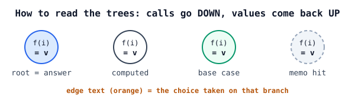

Every top-down DP in 4 lines: **State** (what changes) → **Choice** (what can I do here) → **Base case** → **memo before return**.

## 1. Coin Change — LC 322 ★★★
[LeetCode 322](https://leetcode.com/problems/coin-change/) · Fewest coins for `amount`, `-1` if impossible.

**Recognise it:** "minimum count, items reusable" → `dfs(amount)` with a loop over coins.
**Your old bug:** the memo write was inside the loop. Write it after the loop.

```python
# LC 322
from typing import List

class Solution:
    def coinChange(self, coins: List[int], amount: int) -> int:
        memo = {0: 0}                       # Base case: amount 0 needs 0 coins

        def dfs(a):
            if a in memo:
                return memo[a]

            res = float('inf')
            # Choice: try every coin
            for c in coins:
                if a - c >= 0:
                    res = min(res, 1 + dfs(a - c))

            memo[a] = res                   # write AFTER the loop
            return res

        ans = dfs(amount)
        return -1 if ans == float('inf') else ans
```

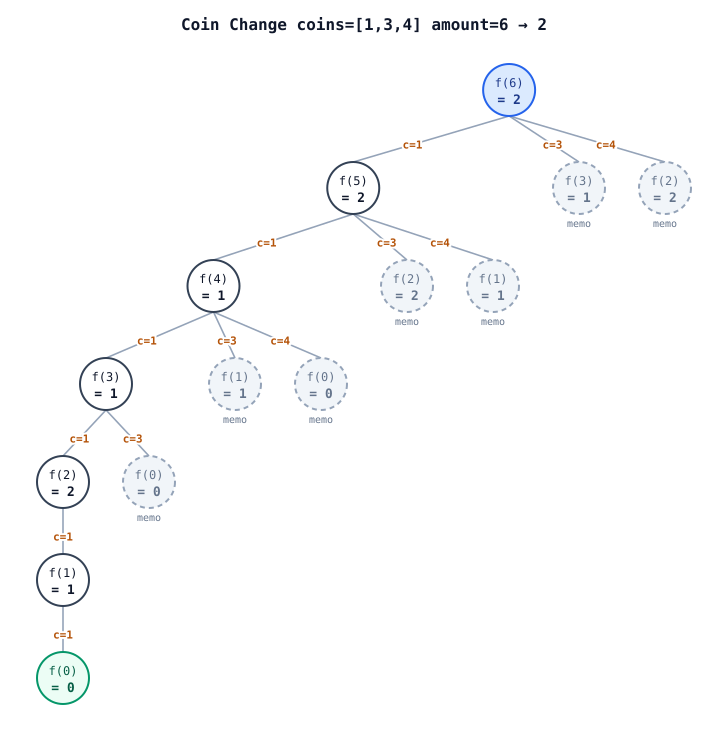

**Dry run** `coins=[1,3,4], amount=6` (greedy would give 4+1+1 = 3 coins, DP finds 3+3 = 2):

```text
dfs(6) = 1 + min(dfs(5), dfs(3), dfs(2))
├─ c=1 → dfs(5) = 1 + min(dfs(4), dfs(2), dfs(1))
│        ├─ dfs(4) = 1 + min(dfs(3), dfs(1), dfs(0)=0)  = 1      ← c=4 hits 0
│        │     ├─ dfs(3) = 1 + min(dfs(2), dfs(0)=0)    = 1      ← c=3 hits 0
│        │     │     └─ dfs(2) = 1 + dfs(1)             = 2
│        │     │           └─ dfs(1) = 1 + dfs(0)       = 1
│        ├─ dfs(2)  (memo) = 2
│        └─ dfs(1)  (memo) = 1
│        → dfs(5) = 1 + min(1, 2, 1) = 2
├─ c=3 → dfs(3) (memo) = 1
└─ c=4 → dfs(2) (memo) = 2
dfs(6) = 1 + min(2, 1, 2) = 2   ✔
```

If `amount` is above ~5000, use the bottom-up version in `dynamic-programming/coin-change/optimal_solution.py`, because deep recursion gets slow.

---

## 2. Count all-0 and all-1 subarrays — Easy ★★★
Reported twice (Jan 2023, Jul 2025): *for a 0/1 array, add the number of all-1 subarrays and all-0 subarrays.*
Same family: [LC 2348 Zero-Filled Subarrays](https://leetcode.com/problems/number-of-zero-filled-subarrays/) · [LC 1513 Substrings With Only 1s](https://leetcode.com/problems/number-of-substrings-with-only-1s/)

**Recognise it:** "count subarrays where all elements are equal" → at each index, `run` = how many equal-subarrays **end here**.

```python
# LC 2348 (variant)
from typing import List

class Solution:
    def countSubarrays(self, nums: List[int]) -> int:
        ans = 0
        run = 0                             # length of current block of equal values

        for i in range(len(nums)):
            if i > 0 and nums[i] == nums[i - 1]:
                run += 1                    # block grows: +1 new subarray ending here per length
            else:
                run = 1                     # new block starts
            ans += run

        return ans
```

**Dry run** `[0,0,1,1,1]`:

```text
i   val  run  ans
0   0    1    1      [0]
1   0    2    3      [0] [0,0]  ← new ones ending at i=1: 2
2   1    1    4      block changes, run resets
3   1    2    6
4   1    3    9      answer = 9   (zeros: 3, ones: 6)  ✔
```

---

## 3. Minimum Path Sum — LC 64 ★★★
[LeetCode 64](https://leetcode.com/problems/minimum-path-sum/) · Cheapest path top-left → bottom-right, moves: right/down. (Jan 2023 OA.)

**Recognise it:** grid + only 2 moves + min/max → `dfs(r, c)` with `(r, c)` memo.
Same shape as your Unique Paths.

```python
# LC 64
from typing import List

class Solution:
    def minPathSum(self, grid: List[List[int]]) -> int:
        R, C = len(grid), len(grid[0])
        memo = {}

        def dfs(r, c):
            # Base case: reached destination
            if r == R - 1 and c == C - 1:
                return grid[r][c]
            # Out of grid: path is invalid
            if r >= R or c >= C:
                return float('inf')
            if (r, c) in memo:
                return memo[(r, c)]

            # Choice: go down or go right
            memo[(r, c)] = grid[r][c] + min(dfs(r + 1, c), dfs(r, c + 1))
            return memo[(r, c)]

        return dfs(0, 0)
```

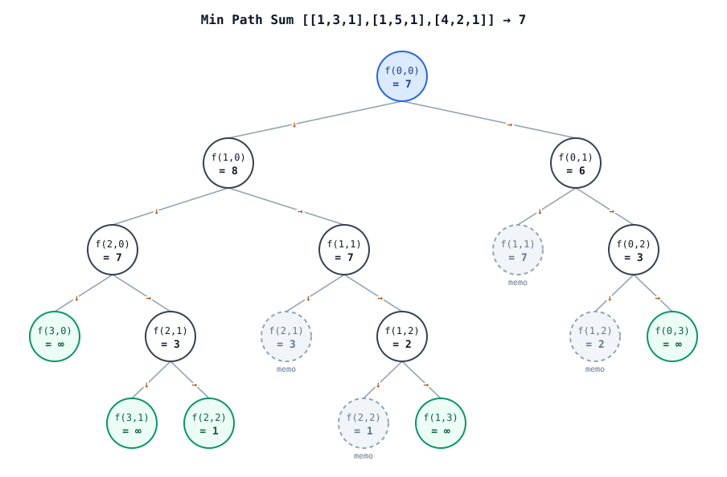

**Dry run** `grid=[[1,3,1],[1,5,1],[4,2,1]]`:

```text
dfs(0,0)=1 + min(↓dfs(1,0), →dfs(0,1))
├─ dfs(1,0)=1 + min(dfs(2,0), dfs(1,1))
│   ├─ dfs(2,0)=4 + min(↓inf, →dfs(2,1))
│   │     └─ dfs(2,1)=2 + dfs(2,2)=2+1 = 3     → dfs(2,0)=7
│   └─ dfs(1,1)=5 + min(↓dfs(2,1)=3 (memo), →dfs(1,2))
│         └─ dfs(1,2)=1 + dfs(2,2)=1+1 = 2     → dfs(1,1)=7
│   → dfs(1,0)=1 + min(7,7) = 8
└─ dfs(0,1)=3 + min(↓dfs(1,1)=7 (memo), →dfs(0,2))
    └─ dfs(0,2)=1 + ↓dfs(1,2)=2 (memo) = 3     → dfs(0,1)=3+3 = 6
dfs(0,0)=1 + min(8, 6) = 7   ✔   path 1→3→1→1→1
```

---

## 4. LCS — LC 1143 ★★★
[LeetCode 1143](https://leetcode.com/problems/longest-common-subsequence/) · Longest common subsequence of two strings. (Reported 2023, 2025, on the "classics" list.)

**Recognise it:** two strings/arrays and "common / match / convert" → state `(i, j)` = suffixes `a[i:]`, `b[j:]`.

```python
# LC 1143
class Solution:
    def longestCommonSubsequence(self, text1: str, text2: str) -> int:
        m, n = len(text1), len(text2)
        memo = {}

        def dfs(i, j):
            # Base case: one string is used up
            if i == m or j == n:
                return 0
            if (i, j) in memo:
                return memo[(i, j)]

            if text1[i] == text2[j]:
                # Match: take it, move both
                memo[(i, j)] = 1 + dfs(i + 1, j + 1)
            else:
                # No match: skip a char from either string
                memo[(i, j)] = max(dfs(i + 1, j), dfs(i, j + 1))
            return memo[(i, j)]

        return dfs(0, 0)
```

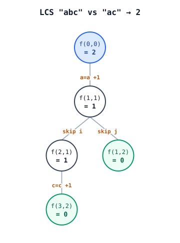

**Dry run** `text1="abc"`, `text2="ac"`:

```text
dfs(0,0)  a==a → 1 + dfs(1,1)
              dfs(1,1)  b≠c → max( dfs(2,1) , dfs(1,2) )
                          ├─ dfs(2,1)  c==c → 1 + dfs(3,2) = 1 + 0 = 1
                          └─ dfs(1,2)  j==n → 0
                        = 1
          = 1 + 1 = 2   ✔  ("ac")
```

---

## 5. Min Deletions + Insertions to convert s1 → s2 — ★★★
Dec 2025 OA. [GFG: Minimum number of deletions and insertions](https://www.geeksforgeeks.org/problems/minimum-number-of-deletions-and-insertions0209/1) · [LC 583 Delete Operation for Two Strings](https://leetcode.com/problems/delete-operation-for-two-strings/)

**Trick:** keep the LCS, delete everything else from s1, insert everything else from s2.
`answer = (m - LCS) + (n - LCS)`.

```python
# LC 583
class Solution:
    def minDistance(self, word1: str, word2: str) -> int:
        m, n = len(word1), len(word2)
        memo = {}

        def dfs(i, j):                      # same as LCS
            if i == m or j == n:
                return 0
            if (i, j) in memo:
                return memo[(i, j)]
            if word1[i] == word2[j]:
                memo[(i, j)] = 1 + dfs(i + 1, j + 1)
            else:
                memo[(i, j)] = max(dfs(i + 1, j), dfs(i, j + 1))
            return memo[(i, j)]

        lcs = dfs(0, 0)
        return (m - lcs) + (n - lcs)
```

**Dry run** `"sea"` → `"eat"`: `LCS = "ea" = 2` → deletions `3-2 = 1` (the `s`) + insertions `3-2 = 1` (the `t`) = **2** ✔

---

## 6. Partition Equal Subset Sum — LC 416 ★★ (and 0/1 Knapsack)
[LeetCode 416](https://leetcode.com/problems/partition-equal-subset-sum/) · Can the array split into 2 subsets of equal sum?

**Recognise it:** each item **once**, hit a target → `dfs(i, remaining)` with **take / skip**.
(0/1 Knapsack = the same shape with `max` instead of `or`. See the block after this one.)

```python
# LC 416
from typing import List

class Solution:
    def canPartition(self, nums: List[int]) -> bool:
        total = sum(nums)
        if total % 2:
            return False                    # odd total can never split evenly
        half = total // 2
        n = len(nums)
        memo = {}

        def dfs(i, rem):
            # Base case: target hit
            if rem == 0:
                return True
            # Dead ends: no items left, or overshoot
            if i == n or rem < 0:
                return False
            if (i, rem) in memo:
                return memo[(i, rem)]

            # Choice: take nums[i]  OR  skip it
            memo[(i, rem)] = dfs(i + 1, rem - nums[i]) or dfs(i + 1, rem)
            return memo[(i, rem)]

        return dfs(0, half)
```

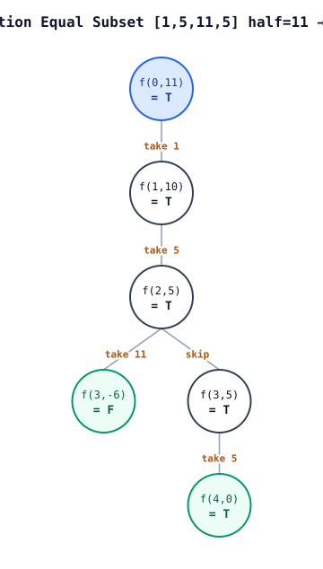

**Dry run** `[1,5,11,5]`, `half=11`:

```text
dfs(0,11)
├─ take 1 → dfs(1,10)
│    ├─ take 5 → dfs(2,5)
│    │    ├─ take 11 → rem = -6 → False
│    │    └─ skip    → dfs(3,5)
│    │         ├─ take 5 → dfs(4,0) → rem==0 → True ✔
│    │         └─ (not needed, `or` short-circuits)
│    └─ ...
└─ ...
→ True   (1 + 5 + 5 = 11)
```

```python
# GFG 0/1 Knapsack
from typing import List

class Solution:
    def knapSack(self, W: int, wt: List[int], val: List[int]) -> int:
        n = len(wt)
        memo = {}

        def dfs(i, cap):
            if i == n:
                return 0
            if (i, cap) in memo:
                return memo[(i, cap)]

            res = dfs(i + 1, cap)                           # skip
            if wt[i] <= cap:
                res = max(res, val[i] + dfs(i + 1, cap - wt[i]))   # take
            memo[(i, cap)] = res
            return res

        return dfs(0, W)
```

[GFG 0-1 Knapsack](https://www.geeksforgeeks.org/problems/0-1-knapsack-problem0945/1)

---

## 7. Longest Increasing Subsequence — LC 300 ★★
[LeetCode 300](https://leetcode.com/problems/longest-increasing-subsequence/) · The Jan 2026 OA "gates" question is a 2D version of this.

**Recognise it:** "longest chain where each next is bigger" → `dfs(i)` = longest chain **starting at i**.

```python
# LC 300
from typing import List

class Solution:
    def lengthOfLIS(self, nums: List[int]) -> int:
        n = len(nums)
        memo = {}

        def dfs(i):
            if i in memo:
                return memo[i]

            best = 1                        # nums[i] alone
            # Choice: extend with any later bigger element
            for j in range(i + 1, n):
                if nums[j] > nums[i]:
                    best = max(best, 1 + dfs(j))

            memo[i] = best
            return best

        return max(dfs(i) for i in range(n))
```

**Dry run** `[10,9,2,5,3,7,101,18]`, the tree from `i=2` (value 2):

```text
dfs(2) [2]  = 1 + max( dfs(3), dfs(4), dfs(5), dfs(6), dfs(7) )
├─ dfs(3) [5] = 1 + max( dfs(5)[7]=?, dfs(6)[101], dfs(7)[18] )
│     ├─ dfs(5) [7]  = 1 + max( dfs(6)=1, dfs(7)=1 ) = 2     ← 7→101 or 7→18
│     ├─ dfs(6) [101] = 1
│     └─ dfs(7) [18]  = 1
│     = 1 + 2 = 3                                            ← 5→7→101
├─ dfs(4) [3] = 1 + max( dfs(5)=2 (memo), ...) = 3           ← 3→7→101
├─ dfs(5)=2 (memo)  dfs(6)=1  dfs(7)=1
dfs(2) = 1 + 3 = 4   ✔  (2,5,7,101)
```

**If N is large (1e5)**, `O(N²)` times out. Use this one:

```python
# LC 300 fast
from bisect import bisect_left
from typing import List

class Solution:
    def lengthOfLIS(self, nums: List[int]) -> int:
        tails = []                          # tails[k] = smallest tail of an increasing run of length k+1
        for x in nums:
            pos = bisect_left(tails, x)
            if pos == len(tails):
                tails.append(x)             # extends the longest run
            else:
                tails[pos] = x              # better (smaller) tail
        return len(tails)
```

---

## 8. Longest Increasing Path in a Matrix — LC 329 ★★
[LeetCode 329](https://leetcode.com/problems/longest-increasing-path-in-a-matrix/) · Memo DFS, 4 directions. No `visited` is needed because strictly increasing means no cycles.

```python
# LC 329
from typing import List

class Solution:
    def longestIncreasingPath(self, matrix: List[List[int]]) -> int:
        R, C = len(matrix), len(matrix[0])
        memo = {}

        def dfs(r, c):
            if (r, c) in memo:
                return memo[(r, c)]

            best = 1                        # the cell itself
            # Choice: move to any strictly bigger neighbour
            for dr, dc in ((1, 0), (-1, 0), (0, 1), (0, -1)):
                nr, nc = r + dr, c + dc
                if 0 <= nr < R and 0 <= nc < C and matrix[nr][nc] > matrix[r][c]:
                    best = max(best, 1 + dfs(nr, nc))

            memo[(r, c)] = best
            return best

        return max(dfs(r, c) for r in range(R) for c in range(C))
```

**Dry run** `[[9,9,4],[6,6,8],[2,1,1]]`, start at the `1` at `(2,1)`:

```text
dfs(2,1) [1] = 1 + max over bigger neighbours
├─ ↑ (1,1)=6 → dfs(1,1) [6]
│      └─ ↑ (0,1)=9 → dfs(0,1) = 1          → dfs(1,1) = 2
├─ ← (2,0)=2 → dfs(2,0) [2]
│      └─ ↑ (1,0)=6 → dfs(1,0) [6]
│             └─ ↑ (0,0)=9 → dfs(0,0) = 1   → dfs(1,0) = 2
│                                           → dfs(2,0) = 3
dfs(2,1) = 1 + max(2, 3) = 4   ✔   path 1 → 2 → 6 → 9
```

---

## 9. Coin Change II — LC 518 ★ (count the ways)
[LeetCode 518](https://leetcode.com/problems/coin-change-ii/) · May 2022 OA: *"count ways to reach a target sum with given denominations"*.

**Recognise it:** "number of ways/combinations" → index `i` on the coin + remaining `rem`. Taking a coin **keeps `i`** (reusable). Skipping **moves `i`**. This avoids counting `1+2` and `2+1` twice.

```python
# LC 518
from typing import List

class Solution:
    def change(self, amount: int, coins: List[int]) -> int:
        n = len(coins)
        memo = {}

        def dfs(i, rem):
            if rem == 0:
                return 1                    # one valid combination found
            if i == n or rem < 0:
                return 0
            if (i, rem) in memo:
                return memo[(i, rem)]

            # Choice: use coin i again  +  move on to the next coin
            memo[(i, rem)] = dfs(i, rem - coins[i]) + dfs(i + 1, rem)
            return memo[(i, rem)]

        return dfs(0, amount)
```

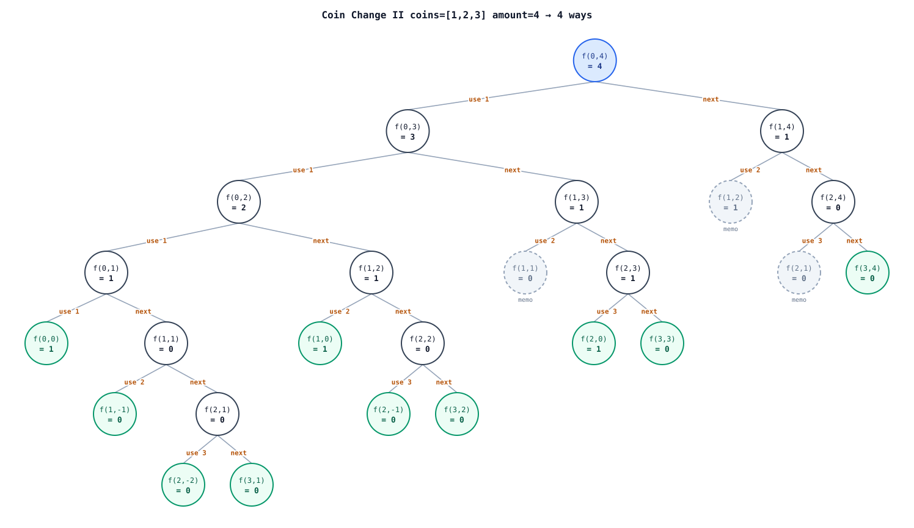

**Dry run** `amount=4`, `coins=[1,2,3]` (answer 4: `1+1+1+1`, `1+1+2`, `2+2`, `1+3`). `f(i, rem)` = ways using coins from index `i`:

```text
f(0,4) = f(0,3) + f(1,4)               take 1 again | skip coin 1
├─ f(0,3) = f(0,2) + f(1,3)
│   ├─ f(0,2) = f(0,1) + f(1,2)
│   │   ├─ f(0,1) = f(0,0)=1 + f(1,1)=0      = 1     ← 1+1+1+1
│   │   └─ f(1,2) = f(1,0)=1 + f(2,2)=0      = 1     ← 1+1+2
│   │   = 2
│   └─ f(1,3) = f(1,1)=0 + f(2,3)
│        └─ f(2,3) = f(2,0)=1 + f(3,3)=0     = 1     ← 1+3
│        = 1
│   = 3
└─ f(1,4) = f(1,2)=1 + f(2,4)=0              = 1     ← 2+2
f(0,4) = 3 + 1 = 4   ✔
```

---

## 10. Edit Distance — LC 72 ★
[LeetCode 72](https://leetcode.com/problems/edit-distance/) · Min insert/delete/replace to convert word1 → word2. Same `(i, j)` shape as LCS.

```python
# LC 72
class Solution:
    def minDistance(self, word1: str, word2: str) -> int:
        m, n = len(word1), len(word2)
        memo = {}

        def dfs(i, j):
            # Base case: one side finished, rest must be deleted / inserted
            if i == m:
                return n - j
            if j == n:
                return m - i
            if (i, j) in memo:
                return memo[(i, j)]

            if word1[i] == word2[j]:
                memo[(i, j)] = dfs(i + 1, j + 1)                  # free
            else:
                memo[(i, j)] = 1 + min(
                    dfs(i + 1, j),          # delete word1[i]
                    dfs(i, j + 1),          # insert word2[j]
                    dfs(i + 1, j + 1),      # replace
                )
            return memo[(i, j)]

        return dfs(0, 0)
```

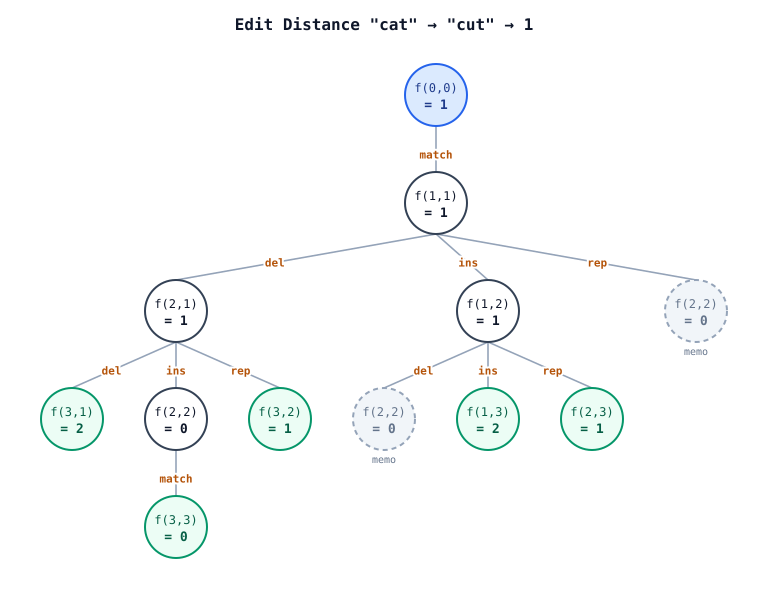

**Dry run** `"cat"` → `"cut"`:

```text
dfs(0,0)  c==c → dfs(1,1)
dfs(1,1)  a≠u  → 1 + min( dfs(2,1)  delete,
                          dfs(1,2)  insert,
                          dfs(2,2)  replace )
                          └─ dfs(2,2)  t==t → dfs(3,3) → i==m → n-j = 0
                 = 1 + min(1, ?, 0) = 1   ✔  (replace 'a' with 'u')
```

---

# Greedy

Greedy test: *"Is there one rule that is never wrong locally?"* If not, it's DP. Most greedy answers here are one pass, so the dry run is a trace table.

## 11. Gas Station — LC 134 ★★
[LeetCode 134](https://leetcode.com/problems/gas-station/) · Sep 2025 interview.

**Idea:** If total gas < total cost → impossible. Else, whenever the tank goes negative at `i`, none of the stations from `start..i` can be the start. Restart at `i+1`.

```python
# LC 134
from typing import List

class Solution:
    def canCompleteCircuit(self, gas: List[int], cost: List[int]) -> int:
        if sum(gas) < sum(cost):
            return -1                       # not enough fuel in total

        tank = 0
        start = 0
        for i in range(len(gas)):
            tank += gas[i] - cost[i]
            if tank < 0:                    # can't reach i+1 from `start`
                tank = 0
                start = i + 1
        return start
```

**Dry run** `gas=[1,2,3,4,5]`, `cost=[3,4,5,1,2]` (sums 15 ≥ 15 ✔):

```text
i  gas-cost  tank  start
0   -2       -2→0   1     tank<0, reset
1   -2       -2→0   2
2   -2       -2→0   3
3   +3        3     3
4   +3        6     3     answer = 3  ✔
```

---

## 12. Monotone Increasing Digits — LC 738 ★★
[LeetCode 738](https://leetcode.com/problems/monotone-increasing-digits/) · 2025 campus OA: largest number ≤ N with non-decreasing digits.

**Idea:** Scan right to left. Whenever `d[i-1] > d[i]`, decrease `d[i-1]` by 1 and remember `i` as the point after which everything becomes `9`.

```python
# LC 738
class Solution:
    def monotoneIncreasingDigits(self, n: int) -> int:
        d = list(str(n))
        mark = len(d)                       # from here on, all 9s

        for i in range(len(d) - 1, 0, -1):
            if d[i - 1] > d[i]:
                d[i - 1] = str(int(d[i - 1]) - 1)
                mark = i

        for i in range(mark, len(d)):
            d[i] = '9'
        return int(''.join(d))
```

**Dry run** `n = 332`:

```text
d = [3,3,2]  mark=3
i=2: d[1]=3 > d[2]=2 → d[1]=2, mark=2   → [3,2,2]
i=1: d[0]=3 > d[1]=2 → d[0]=2, mark=1   → [2,2,2]
fill from mark=1 with 9 → [2,9,9] → 299  ✔
```

---

## 13. Jump Game I and II — LC 55 / 45 ★

[LC 55](https://leetcode.com/problems/jump-game/) · [LC 45](https://leetcode.com/problems/jump-game-ii/) · Track the farthest reachable index. For LC 45, count a jump each time you reach the end of the current window.

```python
# LC 55
from typing import List

class Solution:
    def canJump(self, nums: List[int]) -> bool:
        far = 0
        for i in range(len(nums)):
            if i > far:
                return False                # stuck before reaching i
            far = max(far, i + nums[i])
        return True
```

```python
# LC 45
from typing import List

class Solution:
    def jump(self, nums: List[int]) -> int:
        jumps = 0
        end = 0                             # edge of the current jump's reach
        far = 0                             # best reach seen so far
        for i in range(len(nums) - 1):
            far = max(far, i + nums[i])
            if i == end:                    # must jump now
                jumps += 1
                end = far
        return jumps
```

**Dry run** LC 45 `[2,3,1,1,4]`:

```text
i  far  end  jumps
0   2    0→2   1     jump 1 covers up to index 2
1   4    2
2   4    2→4   2     jump 2 covers the end   → 2  ✔
```

---

## 14. Intervals: Non-overlapping (LC 435) and Min Platforms / Rooms (LC 253) ★

[LC 435](https://leetcode.com/problems/non-overlapping-intervals/) (activity selection) · [LC 253 Meeting Rooms II](https://leetcode.com/problems/meeting-rooms-ii/) (premium; same as [GFG Minimum Platforms](https://www.geeksforgeeks.org/problems/minimum-platforms-1587115620/1)).

**435:** sort by **end**, keep an interval if it starts after the last kept one ends. Answer is `n - kept`.
**253:** sort by start, keep a min-heap of end times. If the earliest end ≤ new start, reuse that room.

```python
# LC 435
from typing import List

class Solution:
    def eraseOverlapIntervals(self, intervals: List[List[int]]) -> int:
        intervals.sort(key=lambda x: x[1])  # earliest finish first
        kept = 0
        last_end = float('-inf')
        for s, e in intervals:
            if s >= last_end:               # no overlap → keep
                kept += 1
                last_end = e
        return len(intervals) - kept
```

```python
# LC 253
import heapq
from typing import List

class Solution:
    def minMeetingRooms(self, intervals: List[List[int]]) -> int:
        intervals.sort()                    # by start
        heap = []                           # end times of rooms in use
        for s, e in intervals:
            if heap and heap[0] <= s:
                heapq.heappop(heap)         # a room is free, reuse it
            heapq.heappush(heap, e)
        return len(heap)
```

**Dry run** LC 253 `[[0,30],[5,10],[15,20]]`:

```text
[0,30]  heap=[]        → push 30        heap=[30]
[5,10]  30 <= 5? no    → push 10        heap=[10,30]   rooms=2
[15,20] 10 <= 15? yes  → pop 10, push 20 heap=[20,30]  → answer 2  ✔
```

---

## 15. Alternating Signal Extractor — Wiggle Subsequence LC 376 ★★
Feb 2026 OA ("longest subsequence whose values alternate"). [LeetCode 376](https://leetcode.com/problems/wiggle-subsequence/)

**Idea:** Two counters: `up` = longest wiggle ending with a rise, `down` = ending with a fall. A rise extends a fall and the reverse.
If your version says "alternate between positive and negative non-zero values", **drop the zeros first**, then count sign changes. Zeros can't join the pattern.

```python
# LC 376
from typing import List

class Solution:
    def wiggleMaxLength(self, nums: List[int]) -> int:
        if len(nums) < 2:
            return len(nums)
        up = down = 1
        for i in range(1, len(nums)):
            if nums[i] > nums[i - 1]:
                up = down + 1               # rise follows a fall
            elif nums[i] < nums[i - 1]:
                down = up + 1               # fall follows a rise
        return max(up, down)
```

**Dry run** `[1,7,4,9,2,5]`:

```text
i  val  move   up  down
0   1          1   1
1   7   rise   2   1
2   4   fall   2   3
3   9   rise   4   3
4   2   fall   4   5
5   5   rise   6   5     → 6  ✔
```

---

## 16. Pairwise Distinct Partition — Complex (Feb 2026) ★
Reported as "split into the **maximum** number of contiguous subarrays that each contain only distinct elements". That wording is wrong as written, since all-singletons gives `n`. The real version is almost certainly **minimum** parts (or a partition-by-last-occurrence variant, [LC 763 Partition Labels](https://leetcode.com/problems/partition-labels/)). **Read the statement on exam day.** This is the min-parts greedy:

```python
# GFG Distinct Partition (min parts)
from typing import List

class Solution:
    def minParts(self, arr: List[int]) -> int:
        if not arr:
            return 0
        parts = 1
        seen = set()
        for x in arr:
            if x in seen:                   # duplicate → cut before x
                parts += 1
                seen = set()
            seen.add(x)
        return parts
```

**Dry run** `[1,2,1,3,3]`:

```text
x=1 seen={1}
x=2 seen={1,2}
x=1 dup → parts=2, seen={}→{1}
x=3 seen={1,3}
x=3 dup → parts=3, seen={}→{3}      → 3  ([1,2] [1,3] [3])
```

---

## 17. Max Units on a Truck — LC 1710 (Easy) ★
[LeetCode 1710](https://leetcode.com/problems/maximum-units-on-a-truck/) · Sort by units per box, take greedily. Good for a quick Q1.

```python
# LC 1710
from typing import List

class Solution:
    def maximumUnits(self, boxTypes: List[List[int]], truckSize: int) -> int:
        boxTypes.sort(key=lambda x: -x[1])  # most valuable box first
        total = 0
        for count, units in boxTypes:
            take = min(count, truckSize)
            total += take * units
            truckSize -= take
            if truckSize == 0:
                break
        return total
```

---

# Stack, binary search (little hard)

## 18. Max Distance `j - i` with `A[i] <= A[j]` — LC 962 ★★★
Jul 2025 OA. [LeetCode 962 Maximum Width Ramp](https://leetcode.com/problems/maximum-width-ramp/)

**Idea:** Candidates for the left end `i` are only the indices where the value hits a new **minimum** (decreasing stack). Then scan `j` from the right, and while `A[stack top] <= A[j]` pop and update the answer. A bigger `j` is always better, so each popped `i` is finished.

```python
# LC 962
from typing import List

class Solution:
    def maxWidthRamp(self, nums: List[int]) -> int:
        n = len(nums)
        stack = []                          # indices with strictly decreasing values
        for i in range(n):
            if not stack or nums[i] < nums[stack[-1]]:
                stack.append(i)

        ans = 0
        for j in range(n - 1, -1, -1):      # biggest j first
            while stack and nums[stack[-1]] <= nums[j]:
                ans = max(ans, j - stack.pop())
        return ans
```

**Dry run** `[6,0,8,2,1,5]`:

```text
Build stack (new minimums): i=0 (6) push, i=1 (0) push, 8,2,1,5 are not < 0 → stack=[0,1]

j=5 (5): top=1 (0) <= 5 → ans=5-1=4, pop      stack=[0]
         top=0 (6) <= 5? no
j=4..1 : top=0 (6) <= nums[j]? no
j=2 (8): top=0 (6) <= 8 → ans=max(4, 2-0)=4, pop   → answer 4  ✔  (i=1, j=5)
```

---

## 19. Split Array, minimise the largest sum — LC 410 ★★
Dec 2025 OA (Q1!). [LeetCode 410](https://leetcode.com/problems/split-array-largest-sum/)

**Recognise it:** "split into K parts, minimise the maximum" → **binary search on the answer** + greedy check.
Answer lies in `[max(nums), sum(nums)]`. For a candidate `limit`, greedily pack numbers into a part until it would overflow, and count parts. If `parts <= k`, `limit` works, so try smaller.

```python
# LC 410
from typing import List

class Solution:
    def splitArray(self, nums: List[int], k: int) -> int:

        def parts_needed(limit):
            parts = 1
            cur = 0
            for x in nums:
                if cur + x > limit:         # start a new part
                    parts += 1
                    cur = x
                else:
                    cur += x
            return parts

        lo, hi = max(nums), sum(nums)
        while lo < hi:
            mid = (lo + hi) // 2
            if parts_needed(mid) <= k:
                hi = mid                    # feasible → try smaller
            else:
                lo = mid + 1                # too many parts → raise limit
        return lo
```

**Dry run** `[7,2,5,10,8]`, `k=2`: search range `[10, 32]`

```text
lo=10 hi=32 mid=21 → 7+2+5=14 (+10 > 21, new part) 10+8=18 → 2 parts ≤ 2 → hi=21
lo=10 hi=21 mid=15 → 7+2+5=14 | 10 | 8 → 3 parts > 2 → lo=16
lo=16 hi=21 mid=18 → 7+2+5=14 | 10+8=18 → 2 parts → hi=18
lo=16 hi=18 mid=17 → 14 | 10 | 8 → 3 parts → lo=18
lo=hi=18 → answer 18  ✔
```

---

# Graphs: BFS

Graph template used in all three: a `deque`, **mark visited when you push** (not when you pop), process level by level when you need time/distance.

## 20. Rotting Oranges — LC 994 ★★
[LeetCode 994](https://leetcode.com/problems/rotting-oranges/) · 2023 interview. Multi-source BFS, one level = one minute.

```python
# LC 994
from collections import deque
from typing import List

class Solution:
    def orangesRotting(self, grid: List[List[int]]) -> int:
        R, C = len(grid), len(grid[0])
        q = deque()
        fresh = 0

        for r in range(R):
            for c in range(C):
                if grid[r][c] == 2:
                    q.append((r, c))        # all rotten oranges start together
                elif grid[r][c] == 1:
                    fresh += 1

        minutes = 0
        while q and fresh:
            minutes += 1
            for _ in range(len(q)):         # one full level = 1 minute
                r, c = q.popleft()
                for dr, dc in ((1, 0), (-1, 0), (0, 1), (0, -1)):
                    nr, nc = r + dr, c + dc
                    if 0 <= nr < R and 0 <= nc < C and grid[nr][nc] == 1:
                        grid[nr][nc] = 2    # mark on push
                        fresh -= 1
                        q.append((nr, nc))

        return -1 if fresh else minutes
```

**Dry run** `[[2,1,1],[1,1,0],[0,1,1]]`:

```text
start: q=[(0,0)]  fresh=6
min 1: (0,0) → (0,1),(1,0)            fresh=4
min 2: (0,1) → (0,2),(1,1) ; (1,0) → –   fresh=2
min 3: (1,1) → (2,1)                  fresh=1
min 4: (2,1) → (2,2)                  fresh=0  → stop → 4  ✔
```

---

## 21. Number of Islands — LC 200 ★★
[LeetCode 200](https://leetcode.com/problems/number-of-islands/) · Each time you find an unvisited `'1'`, count +1 and BFS-flood the island.

```python
# LC 200
from collections import deque
from typing import List

class Solution:
    def numIslands(self, grid: List[List[str]]) -> int:
        R, C = len(grid), len(grid[0])
        count = 0

        for r in range(R):
            for c in range(C):
                if grid[r][c] == '1':
                    count += 1              # new island found
                    grid[r][c] = '0'        # mark visited
                    q = deque([(r, c)])
                    while q:
                        x, y = q.popleft()
                        for dx, dy in ((1, 0), (-1, 0), (0, 1), (0, -1)):
                            nx, ny = x + dx, y + dy
                            if 0 <= nx < R and 0 <= ny < C and grid[nx][ny] == '1':
                                grid[nx][ny] = '0'
                                q.append((nx, ny))
        return count
```

**Dry run** `[[1,1,0],[0,1,0],[0,0,1]]`:

```text
(0,0)=1 → count=1, BFS: (0,0)→(0,1)→(1,1)   island A sunk
(2,2)=1 → count=2, BFS: just (2,2)           island B sunk   → 2  ✔
```

---

## 22. Deep Space Telescope — flip at most one 0 — LC 827 ★ (stretch, do only if time)
Feb 2026 OA "Hard". [LeetCode 827 Making A Large Island](https://leetcode.com/problems/making-a-large-island/)

**Idea:** (1) BFS-label every island with an id and its size. (2) For each `0`, collect the **distinct** neighbour island ids and add `1 + sum(sizes)`. Use a set so one island isn't counted twice.

```python
# LC 827
from collections import deque
from typing import List

class Solution:
    def largestIsland(self, grid: List[List[int]]) -> int:
        R, C = len(grid), len(grid[0])
        dirs = ((1, 0), (-1, 0), (0, 1), (0, -1))
        comp = [[0] * C for _ in range(R)]  # island id per cell, 0 = none
        size = {0: 0}
        cid = 2

        # Step 1: label islands with BFS
        for r in range(R):
            for c in range(C):
                if grid[r][c] == 1 and comp[r][c] == 0:
                    comp[r][c] = cid
                    q = deque([(r, c)])
                    cnt = 0
                    while q:
                        x, y = q.popleft()
                        cnt += 1
                        for dx, dy in dirs:
                            nx, ny = x + dx, y + dy
                            if 0 <= nx < R and 0 <= ny < C and grid[nx][ny] == 1 and comp[nx][ny] == 0:
                                comp[nx][ny] = cid
                                q.append((nx, ny))
                    size[cid] = cnt
                    cid += 1

        # Step 2: try flipping each 0
        best = max(size.values())           # already-all-ones grid case
        for r in range(R):
            for c in range(C):
                if grid[r][c] == 0:
                    ids = set()
                    for dx, dy in dirs:
                        nx, ny = r + dx, c + dy
                        if 0 <= nx < R and 0 <= ny < C:
                            ids.add(comp[nx][ny])      # comp 0 has size 0
                    best = max(best, 1 + sum(size[i] for i in ids))
        return best
```

**Dry run** `[[1,0],[0,1]]`:

```text
Label: (0,0)→id 2 size 1 ; (1,1)→id 3 size 1
Flip (0,1): neighbours (0,0)=2, (1,1)=3 → ids {2,3} → 1+1+1 = 3
Flip (1,0): same → 3        → answer 3  ✔
```

---

# Last 20 minutes before the exam

1. **Read all 4 questions first (5 min).** Pick Easy plus the one Medium that looks like a pattern above.
2. **Easy (Q1):** run it on the sample, then on edge cases (`n=1`, all equal, all negative, `0`).
3. **Medium:** write the brute force first. It gets partial test cases. Then optimise using the constraint rule from section 0.
4. **Only now** touch Hard/Complex, and only for partial marks.
5. **Pre-submit:** check the printed format, the `% 1e9+7`, and that you used `sys.stdin`.

Cue → pattern:

| You see... | Use |
|---|---|
| "min coins/ways to reach X", reusable | Coin Change (§1, §9) |
| two strings, "convert / common / match" | LCS shape (§4, §5, §10) |
| each item once, target sum | take/skip (§6) |
| grid, move right/down only | `dfs(r, c)` (§3) |
| "chain where each next is bigger" | LIS (§7, §8) |
| "split into K parts, minimise the max" | binary search on answer (§19) |
| `A[i] <= A[j]`, maximise `j - i` | monotone stack (§18) |
| min time / fewest steps in a grid | BFS (§20–22) |
| "largest number ≤ N with property" | greedy on digits (§12) |
| subarrays of equal values | run length (§2) |


---
---

# PART 2 — Real Nov 2026 questions (from Reddit posts)

**What the posts show:** the same set appeared in several cities (Hyderabad, Pune, Ghaziabad). **Cards** came up in 3 separate posts and **Flags/Strips** in 2. Expect repeats.
**Format confirmed:** 4 questions, scored by **test cases (x/12)**. Partial passes count, so always submit a brute force before you optimise.
**Only Easy / Medium / little-hard questions are solved here.** The skipped ones are listed at the end with the reason.

### How to read the tree pictures


- **Top circle** = the first call. Its value is the answer.
- **Solid circle** = computed. **Dashed grey** = memo hit (returned instantly, not expanded).
- **Edge text** = the choice made on that branch.
- Read **top → down** for the calls, then **bottom → up** for the values.

### Priority for Part 2

| # | Question | Pattern | Level | Seen |
|---|---|---|---|---|
| P1 | Max Sum of Cards (≤ R from right) | prefix / sliding window | Easy | ★★★ 3 posts |
| P2 | Max Flags from Strips (≤ K cuts) | greedy | Med | ★★ 2 posts |
| P3 | Lift Jitter direction changes | simulation | Easy | ★★ |
| P4 | Snake draft team difference | sort + simulate | Easy | ★ |
| P5 | Select K points, ≤ Q per category | greedy | Easy | ★ |
| P6 | Event Table Seating | math | Easy | ★ |
| P7 | Garden tiles/dominoes, Nurse shifts | Fibonacci / mod | Easy | ★ |
| P8 | Tasks into weeks (flag rule) | top-down `dfs(i)` | Med | ★★ |
| P9 | Stakes exchange (min cost) + GCD flipping machines | top-down `dfs(i, swapped)` | Med | ★★ |
| P10 | Gear changing on segments | top-down `dfs(i, gear)` | Med | ★★ |
| P11 | LPS with one mismatched pair | top-down `dfs(l, r, used)` | Med | ★★ |
| P12 | Two Machine Task Scheduling | top-down `dfs(i, ta, tb)` | Med | ★ |
| P13 | Painting rooms with box sizes | coin-change top-down | Med | ★ |
| P14 | Maximum Free Coffees | greedy | Med | ★ |
| P15 | Mountain Houses dustbins | binary search + greedy | Med+ | ★ |

**Shortcut to remember:** "Pick from both ends" → loop over how many come from the right. "Rows that can be swapped/flipped" → `dfs(i, flipped)`. "Split in order into groups" → `dfs(i)` + a loop over where the group ends. "Minimise the maximum" → binary search on the answer.

---

## P1. Maximum Sum of Cards — Easy ★★★
Pick exactly `T` cards from the two ends, **at most `R` from the right**. Maximise the sum.
Related: [LC 1423 Maximum Points You Can Obtain from Cards](https://leetcode.com/problems/maximum-points-you-can-obtain-from-cards/)

**Why the posters got TLE:** they recomputed `sum()` for each split (O(T²)) or used recursion. Instead, start with all `T` from the left, then **slide**: drop one left card, add one right card.

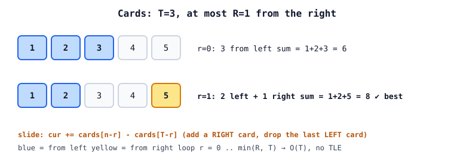

```python
# P1 cards
from typing import List

class Solution:
    def maxCards(self, cards: List[int], T: int, R: int) -> int:
        n = len(cards)
        cur = sum(cards[:T])                # r = 0: all T from the left
        best = cur
        # r = cards taken from the right (at most R, at most T)
        for r in range(1, min(R, T) + 1):
            cur += cards[n - r] - cards[T - r]   # add right card, drop last left card
            best = max(best, cur)
        return best
```

**Dry run** `cards=[1,2,3,4,5]`, `T=3`, `R=1`. The sample input line `1 3` is `R T`; read the input order carefully on the day.

```text
r=0  left 3: 1+2+3        = 6
r=1  left 2 + right 1: 1+2+5 = 8   ← R=1 stops here
answer 8 ✔
```

---

## P2. Maximum Number of Flags (Strips) — Medium ★★
Strips `arr`, flag length `L`, at most `K` cuts. A flag is a piece of length exactly `L` (no joining).

**Key observation (draw it once and you'll remember):**
- Each cut gives **one** flag piece.
- If the strip is an **exact multiple** of `L`, the **last** piece is a flag for free: `full` flags for only `full-1` cuts.
- So do exact-multiple strips **first, fewest cuts first** (they hold the free bonuses), then spend the leftover cuts anywhere.

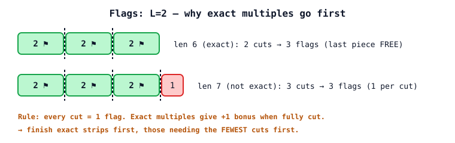

```python
# P2 flags
from typing import List

class Solution:
    def maxFlags(self, arr: List[int], L: int, K: int) -> int:
        exact = []                          # strips that are multiples of L
        other = []
        for s in arr:
            full = s // L
            if full == 0:
                continue                    # too short, useless
            if s % L == 0:
                exact.append(full)
            else:
                other.append(full)

        flags = 0
        exact.sort()                        # fewest cuts first = most bonuses
        for full in exact:
            if K >= full - 1:
                flags += full               # full-1 cuts → full flags (bonus +1)
                K -= full - 1
            else:
                flags += K                  # partial: 1 flag per cut
                K = 0

        for full in other:
            use = min(K, full)              # each cut → 1 flag
            flags += use
            K -= use
        return flags
```

**Dry run** `arr=[6,4,7]`, `L=2`, `K=2`:

```text
6 → exact, full=3 (needs 2 cuts)     4 → exact, full=2 (needs 1 cut)     7 → other, full=3
exact sorted: [2, 3]
  full=2: K=2 ≥ 1 → flags=2, K=1
  full=3: K=1 < 2 → partial, flags=3, K=0
other: K=0 → nothing
answer 3 ✔
```

---

## P3. Lift Movement — ignore jitter, count direction changes — Easy ★★
The poster's bug was comparing with `arr[i-1]`. Compare with the **last stable position** and only update it on a real move. (Python ints never overflow, so `long` doesn't matter.)

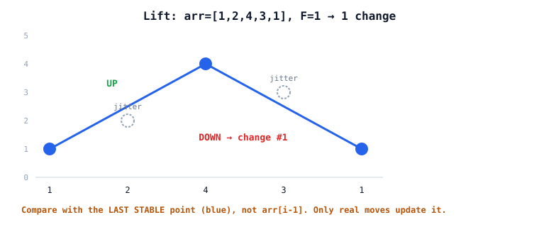

```python
# P3 lift
from typing import List

class Solution:
    def directionChanges(self, arr: List[int], F: int) -> int:
        stable = arr[0]                     # first element is always stable
        last_dir = 0                        # 0 = none yet, +1 up, -1 down
        changes = 0
        for x in arr[1:]:
            if abs(x - stable) <= F:
                continue                    # jitter → ignore
            d = 1 if x > stable else -1
            if last_dir != 0 and d != last_dir:
                changes += 1
            last_dir = d
            stable = x                      # only real moves update stable
        return changes
```

**Dry run** `[1,2,4,3,1]`, `F=1`:

```text
x  |x-stable|  action          stable  dir  changes
2   1          jitter, skip     1       0    0
4   3          up               4       +1   0
3   1          jitter, skip     4       +1   0
1   3          down → change    1       -1   1     ✔
```

---

## P4. Snake Draft — team difference — Easy ★
Sort descending. A takes **1**, then B 2, A 2, B 2, ... Return `|A - B|`. If the statement wants `A - B` signed, drop the `abs`.

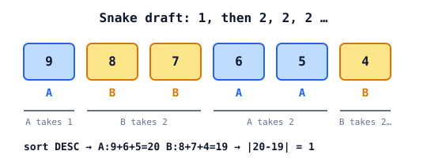

```python
# P4 snake
from typing import List

class Solution:
    def teamDifference(self, arr: List[int]) -> int:
        arr = sorted(arr, reverse=True)
        team = [0, 0]                       # team[0] = A, team[1] = B
        turn = 0                            # A starts
        take = 1                            # first pick is 1 player
        i = 0
        while i < len(arr):
            for _ in range(take):
                if i == len(arr):
                    break
                team[turn] += arr[i]
                i += 1
            turn ^= 1                       # switch coach
            take = 2                        # every later turn picks 2
        return abs(team[0] - team[1])
```

**Dry run** `[9,8,7,6,5,4]`: A gets `9`, B gets `8,7`, A gets `6,5`, B gets `4`. A=20, B=19, so the answer is **1**.

---

## P5. Select exactly K points, at most Q per category — Easy ★
**Greedy:** from each category keep only its top `Q` scores. Pool them all and take the top `K`.

```python
# P5 points
from collections import defaultdict
from typing import List

class Solution:
    def maxScore(self, points: List[List[int]], K: int, Q: int) -> int:
        groups = defaultdict(list)
        for cat, score in points:
            groups[cat].append(score)

        pool = []
        for cat in groups:
            pool += sorted(groups[cat], reverse=True)[:Q]   # best Q of each category

        if len(pool) < K:
            return -1                       # can't pick K (check the statement)
        pool.sort(reverse=True)
        return sum(pool[:K])
```

**Dry run** `K=3, Q=2`: category 1 → `[300,120]` (100 dropped), category 3 → `[500]`. The pool is `[500,300,120]`, so the answer is **920** ✔

---

## P6. Event Table Seating — Easy ★
Two facts. Each table holds at most `T//2` couples, and seats overall must fit `2c + s`.
`answer = max(ceil(c / (T//2)), ceil((2c + s) / T))`. If there are couples and `T < 2`, return `-1`.

```python
# P6 seating
class Solution:
    def minTables(self, c: int, s: int, T: int) -> int:
        if c > 0 and T < 2:
            return -1                       # a couple can't fit anywhere
        need_seats = -(-(2 * c + s) // T)   # ceil division
        if c == 0:
            return need_seats
        need_couples = -(-c // (T // 2))
        return max(need_couples, need_seats)
```

**Dry run** `4 1 3`: couples per table = 1, so 4 tables for couples. Seats are `ceil(9/3) = 3`. `max(4,3)` = **4** ✔

---

## P7. Image set: Garden Tiles and Nurse Shifts — Easy ★

**Garden (1×N row, tile=1, domino=2):** this is your Climbing Stairs, `f(n) = f(n-1) + f(n-2)`.

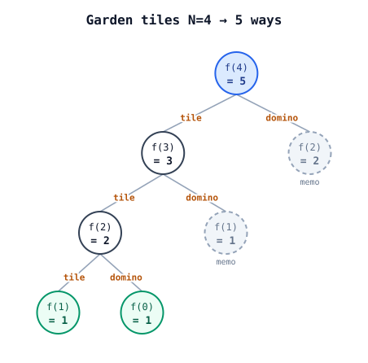

```python
# P7 garden
class Solution:
    def gardenWays(self, n: int) -> int:
        memo = {0: 1, 1: 1}                 # empty row: 1 way; 1 cell: tile only
        def dfs(k):
            if k in memo:
                return memo[k]
            memo[k] = dfs(k - 1) + dfs(k - 2)   # last piece: tile or domino
            return memo[k]
        return dfs(n)
```

**Nurse shifts:** the cycle is `Day → Night → Off`. New index is `(index + D) % 3`.

```python
# P7 nurse
from typing import List

class Solution:
    def shifts(self, shifts: List[str], D: int) -> List[str]:
        order = ["Day", "Night", "Off"]
        return [order[(order.index(s) + D) % 3] for s in shifts]
```

---

## P8. Tasks into Weeks (no week ends on flag 1) — Medium ★★
Tasks in order, week total ≤ `H`, the last task of a week must have flag 0. Minimise weeks.

**Pattern: "split in order into groups"** → `dfs(i)` = min weeks for tasks `i..`. The choice is where this week ends (`j`). Only allowed if `flag[j] == 0`. Stop the loop when the hours go over `H`.

```python
# P8 weeks
from typing import List

class Solution:
    def minWeeks(self, tasks: List[List[int]], H: int) -> int:
        n = len(tasks)
        memo = {}

        def dfs(i):
            if i == n:
                return 0                    # all tasks done
            if i in memo:
                return memo[i]

            res = float('inf')
            hours = 0
            # Choice: this week = tasks i..j
            for j in range(i, n):
                hours += tasks[j][0]
                if hours > H:
                    break                   # week overflows
                if tasks[j][1] == 0:        # week may end only on flag 0
                    res = min(res, 1 + dfs(j + 1))

            memo[i] = res
            return res

        ans = dfs(0)
        return -1 if ans == float('inf') else ans
```

**Dry run** `H=4`, `tasks=[[2,0],[2,1],[2,0],[2,0]]` → **3**:

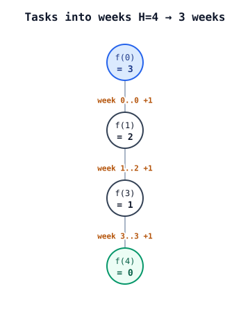

---

## P9. Stakes Exchange (min cost so both columns increase) — Medium ★★
Row `i` = `[A, B, cost]`. Swapping A↔B in row `i` costs `cost` (not allowed if `-1`). Make both columns strictly increasing at minimum cost.
Same problem with costs: [LC 801 Minimum Swaps To Make Sequences Increasing](https://leetcode.com/problems/minimum-swaps-to-make-sequences-increasing/)

**Pattern: each row has 2 states** → `dfs(i, sw)`: row `i` is already fixed as swapped/not, return the min cost for the rows after it.

```python
# P9 stakes
from typing import List

class Solution:
    def minCost(self, stakes: List[List[int]]) -> int:
        n = len(stakes)
        INF = float('inf')
        memo = {}

        def vals(i, sw):
            a, b, _ = stakes[i]
            return (b, a) if sw else (a, b)

        def dfs(i, sw):
            if i == n - 1:
                return 0                    # last row placed, nothing after
            if (i, sw) in memo:
                return memo[(i, sw)]

            pa, pb = vals(i, sw)
            res = INF
            # Choice: keep row i+1, or swap it (if allowed)
            for nsw in (0, 1):
                cost = stakes[i + 1][2]
                if nsw == 1 and cost == -1:
                    continue
                na, nb = vals(i + 1, nsw)
                if na > pa and nb > pb:     # both columns still increasing
                    res = min(res, (cost if nsw else 0) + dfs(i + 1, nsw))

            memo[(i, sw)] = res
            return res

        best = dfs(0, 0)
        if stakes[0][2] != -1:
            best = min(best, stakes[0][2] + dfs(0, 1))
        return -1 if best == INF else best
```

**Dry run** rows `[[1,1,-1],[3,2,2],[5,3,4],[4,7,3]]` → **3** (swap the last row):

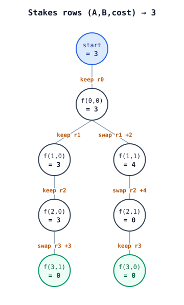

**Same template: Maximize GCD by Flipping Machines** (reported 12/12). Machine = `[left, right, flipCost]`. The value is `gcd(right_i, left_{i+1})` summed, minus flip costs. Use the same `dfs(i, flipped)` and swap `min` for `max`:

```python
# P9 gcd
from math import gcd
from typing import List

class Solution:
    def maxGcdValue(self, machines: List[List[int]]) -> int:
        n = len(machines)
        memo = {}

        def ends(i, fl):
            l, r, _ = machines[i]
            return (r, l) if fl else (l, r)

        def dfs(i, fl):
            if i == n - 1:
                return 0
            if (i, fl) in memo:
                return memo[(i, fl)]
            _, right = ends(i, fl)
            res = float('-inf')
            for nfl in (0, 1):
                left, _ = ends(i + 1, nfl)
                pay = machines[i + 1][2] if nfl else 0
                res = max(res, gcd(right, left) - pay + dfs(i + 1, nfl))
            memo[(i, fl)] = res
            return res

        return max(dfs(0, 0), dfs(0, 1) - machines[0][2])
```

---

## P10. Gears on Segments — Medium ★★
Segment = `[slope, length]`. Riding in gear `g` costs `|slope - g| * length`. Changing `g → g'` costs `s * |g - g'|`. The first gear is free.

**Pattern:** `dfs(i, prev)` with `prev = 0` meaning "no gear yet". The choice is the gear for segment `i`. This is `O(n · G²)`, which is fine for G ≤ 100.

```python
# P10 gears
from typing import List

class Solution:
    def minGearCost(self, segments: List[List[int]], G: int, s: int) -> int:
        n = len(segments)
        memo = {}

        def dfs(i, prev):
            if i == n:
                return 0
            if (i, prev) in memo:
                return memo[(i, prev)]

            slope, length = segments[i]
            res = float('inf')
            # Choice: which gear for segment i
            for g in range(1, G + 1):
                change = 0 if prev == 0 else s * abs(g - prev)
                res = min(res, change + abs(slope - g) * length + dfs(i + 1, g))

            memo[(i, prev)] = res
            return res

        return dfs(0, 0)
```

**Dry run** `segments=[[3,2],[1,1]]`, `G=3`, `s=1` → **2**. Gear 3 on segment 0 is free. Then gear 2 (change 1 + ride 1) or gear 1 (change 2 + ride 0):

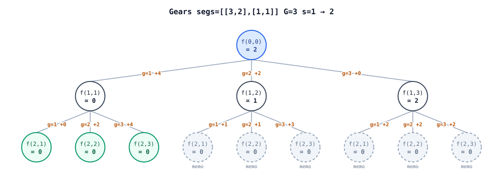

---

## P11. Longest Palindromic Subsequence with ≤ 1 mismatched pair — Medium ★★
This is LPS ([LC 516](https://leetcode.com/problems/longest-palindromic-subsequence/)) with one extra flag `used`. A mismatched pair `s[l] != s[r]` can be taken **once**.

```python
# P11 lps
class Solution:
    def lpsOneMismatch(self, s: str) -> int:
        memo = {}

        def dfs(l, r, used):
            if l > r:
                return 0
            if l == r:
                return 1                    # middle char, no pair
            if (l, r, used) in memo:
                return memo[(l, r, used)]

            if s[l] == s[r]:
                res = 2 + dfs(l + 1, r - 1, used)          # matching pair
            else:
                res = max(dfs(l + 1, r, used), dfs(l, r - 1, used))   # drop one end
                if not used:
                    res = max(res, 2 + dfs(l + 1, r - 1, True))     # spend the mismatch
            memo[(l, r, used)] = res
            return res

        return dfs(0, len(s) - 1, False)
```

**Dry run** `"abca"` → **4** (`a…a` match, `b/c` is the one mismatch):

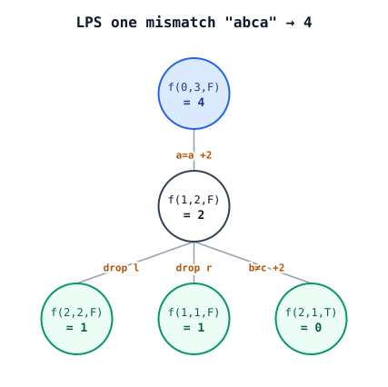

---

## P12. Two Machine Task Scheduling — Medium ★
Each task goes to A (`a[i]`) or B (`b[i]`). `c[i]=1` forces A and `c[i]=2` forces B. Minimise `max(loadA, loadB)`.

**Pattern:** `dfs(i, ta, tb)` = best final makespan. The choice is A or B (if allowed). This is fine when the time sums are small, a few thousand at most. It's the "recursion solves it" approach from the post.

```python
# P12 machines
from typing import List

class Solution:
    def minMakespan(self, a: List[int], b: List[int], c: List[int]) -> int:
        n = len(a)
        memo = {}

        def dfs(i, ta, tb):
            if i == n:
                return max(ta, tb)          # both machines finished
            if (i, ta, tb) in memo:
                return memo[(i, ta, tb)]

            res = float('inf')
            if c[i] != 2:                   # allowed on A
                res = min(res, dfs(i + 1, ta + a[i], tb))
            if c[i] != 1:                   # allowed on B
                res = min(res, dfs(i + 1, ta, tb + b[i]))

            memo[(i, ta, tb)] = res
            return res

        return dfs(0, 0, 0)
```

**Dry run** `a=[3,2,4]`, `b=[2,3,1]`, `c=[0,1,0]` → **3**:

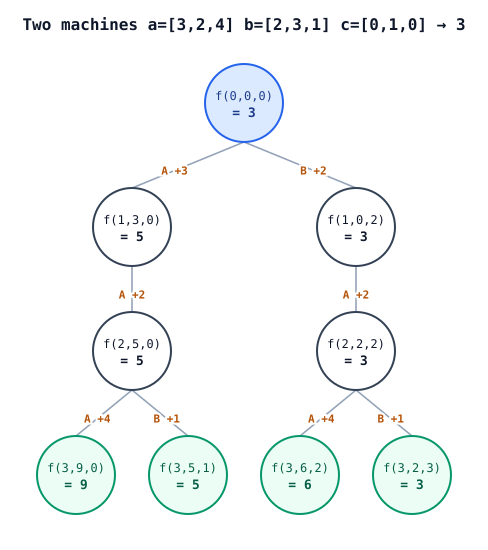

---

## P13. Painting Rooms with small/large boxes — Medium ★ (image set)
Per room: the min cost to get **at least** `need` litres from boxes `(S, Cs)` and `(L, Cl)`. This is **Coin Change** where you overshoot instead of hitting exactly. Rooms are independent, so sum them.

```python
# P13 paint
from typing import List

class Solution:
    def minPaintCost(self, rooms: List[int], S: int, Cs: int, L: int, Cl: int) -> int:
        memo = {}

        def dfs(need):
            if need <= 0:
                return 0                    # room covered
            if need in memo:
                return memo[need]
            # Choice: buy a small box or a large box
            memo[need] = min(Cs + dfs(need - S), Cl + dfs(need - L))
            return memo[need]

        return sum(dfs(r) for r in rooms)
```

⚠ **The image's sample doesn't add up.** For the 6 L room it uses large+small = 320, but 3 small boxes (6 L) = 300. So the true minimum is 200 + 200 + 300 = **700**, not 720. Either the sample is wrong or there's a rule the image leaves out. **Read the real statement.** The tree below is for the 6 L room:

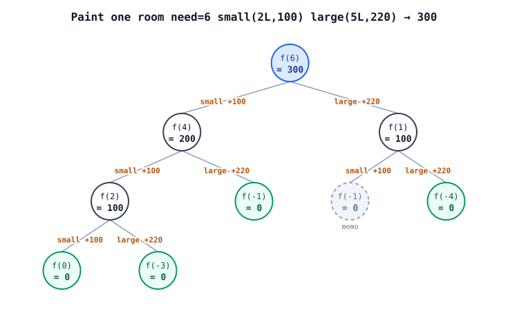

---

## P14. Maximum Free Coffees — Medium ★
Each customer already has `a // R` coffees. The **next** coffee costs `R - a % R` bonus stamps (≤ R). Every coffee after that costs `R`. Per customer, the bonus is capped at `b`.
**Greedy:** buy all the cheap "first top-ups" (cheapest first), then spend what's left in chunks of `R`.

```python
# P14 coffee
from typing import List

class Solution:
    def maxCoffees(self, arr: List[List[int]], R: int, B: int) -> int:
        coffees = 0
        firsts = []                         # (cost of first top-up, bonus cap)
        for a, cap in arr:
            coffees += a // R               # free right now
            need = R - a % R                # stamps to reach the next coffee
            if need <= cap:
                firsts.append((need, cap))

        firsts.sort()
        extra_slots = 0                     # further coffees costing R each
        for need, cap in firsts:
            if need > B:
                break                       # sorted: nothing cheaper remains
            B -= need
            coffees += 1
            extra_slots += (cap - need) // R

        coffees += min(B // R, extra_slots)
        return coffees
```

**Dry run** `R=5, B=12, [[4,11],[2,2],[8,6]]`:

```text
[4,11]: base 0, need 1, cap 11 → first (1), later (11-1)//5 = 2 slots
[2,2] : base 0, need 3 > cap 2 → impossible
[8,6] : base 1, need 2, cap 6  → first (2), later (6-2)//5 = 0 slots
firsts: 1 → B=11, +1 ; 2 → B=9, +1        coffees = 1 + 2 = 3
extra: min(9//5 = 1, 2) = 1               coffees = 4 ✔
```

---

## P15. Mountain Houses — min max walking distance — Medium+ ★
Houses at positions. Bins only at approved houses, `K` bins. Minimise the max distance to the nearest bin.
**Pattern: "minimise the maximum"** → binary search on `D` + greedy check. Leftmost uncovered house `p` → put the bin at the **farthest approved spot ≤ p + D**. It must still be ≥ `p - D`. That bin covers everything up to `bin + D`.

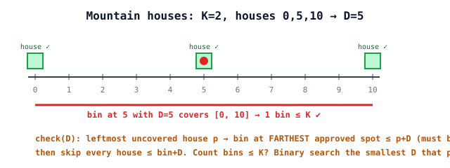

```python
# P15 mountain
from bisect import bisect_right
from typing import List

class Solution:
    def minMaxDistance(self, matrix: List[List[int]], K: int) -> int:
        houses = sorted(p for p, _ in matrix)
        spots = sorted(p for p, ok in matrix if ok == 1)
        if not spots:
            return -1

        def can(D):
            used = 0
            i = 0
            while i < len(houses):
                p = houses[i]                           # leftmost uncovered house
                j = bisect_right(spots, p + D) - 1      # farthest spot still reaching p
                if j < 0 or spots[j] < p - D:
                    return False
                used += 1
                reach = spots[j] + D
                while i < len(houses) and houses[i] <= reach:
                    i += 1                              # all covered by this bin
            return used <= K

        lo, hi = 0, houses[-1] - houses[0]
        while lo < hi:
            mid = (lo + hi) // 2
            if can(mid):
                hi = mid
            else:
                lo = mid + 1
        return lo
```

**Dry run** houses `0,5,10` all approved, `K=2`:

```text
lo=0 hi=10 mid=5 → p=0: spot ≤5 → 5, covers ≤10 → 1 bin ≤ 2 ✔ → hi=5
lo=0 hi=5  mid=2 → p=0→bin 0 (≤2), p=5→bin 5, p=10→bin 10 → 3 bins ✘ → lo=3
lo=3 hi=5  mid=4 → bins 0, 5, 10 → 3 ✘ → lo=5
answer 5 ✔
```

---

## Skipped (Hard / Complex, or the statement is too unclear to solve safely)

| Question | Why skipped |
|---|---|
| Count Valid Signal Strings (forbidden pattern) | KMP automaton + DP. Hard. |
| Minimum Passes to Fill Sand Stacks | Hard grid problem, statement incomplete |
| Painting Planks (V cans, N ≤ 1e6) | DP over a budget up to 1e9. Hard. |
| Non-adjacent monomino N×2 tiling (N ≤ 1e6) | State-machine DP needs bottom-up for N = 1e6, which you said you don't want |
| Kettles / Towers merging | Statements too garbled to pin down |
| Shopping knapsack over days | Ambiguous, and TLE-heavy even for the poster |
| Panel selection, stones/ponds, frog jump, recharge card | Not enough detail recalled |
| Sprague–Grundy game | Game theory. Complex slot. |
| Gears with Teeth (image) | Its sample is self-contradictory: `5,4,3,2,1` has strictly decreasing ratios (0.8, 0.75, 0.67, 0.5), which gives 5, not 3 |

**Strategy from these posts:** Q1 (Cards/Flags/Lift style) is quick to solve, and Q2 is usually a `dfs(i, state)` DP like P8–P12. Get those two to 12/12, and if a solution TLEs, check for a repeated `sum()` or a missing memo first.


---
---

# PART 3 — Gap fill from the research (sliding window, prefix sum, stack, jump DP)

**Why this part exists:** I checked the plan against the latest reports I could read.

- **Nov 2026 retest (GfG, Chennai):** Q1 was a long story-based **simulation**, Q2 a "twisted **greedy + sorting**", Q3 **DP/graph**.
- **May 2026 (GfG):** **two pointers** (pair in a sorted rotated array), **LCS/knapsack**, and a graph **shortest path with an extra constraint**.
- **Sep 2026 off-campus (LeetCode Discuss):** a DSU-style connectivity problem and a **jump-cost DP**, with about a 70% test-case cutoff.
- **Another 2026 LeetCode post:** **sliding window**, an **LCS variant**, **subarray product**.
- **"Most repeated" lists (GitHub, compiled partly from Reddit):** DP 5/5, Arrays + HashMap 5/5, Sliding Window 4/5, Greedy 4/5. Named problems include **Andy's Vacation / Max Vacation Days**, **Monster Defeat**, **Remove Digit to Maximize**, **Largest Number**, **LIS with a bitwise condition**, and **Minimum Platforms** (already covered in §14).

Reddit and LeetCode Discuss block automated readers, so the LeetCode items above come from search snippets only, not the full posts.

| # | Problem | Pattern | Level | Evidence |
|---|---|---|---|---|
| G1 | Max Vacation Days / Max Consecutive Ones III | sliding window | Med | ★★★ PDF + 2025 list |
| G2 | Subarray Product < K (and ≥ K) | sliding window | Med | ★★ 2026 post + PDF |
| G3 | Longest Substring Without Repeating | sliding window | Med | ★★ classic list 2021–26 |
| G4 | Subarray Sum = K / divisible by K | prefix sum + hashmap | Med | ★★ Arrays+HashMap 5/5 |
| G5 | Frog Jump (k steps) | top-down `dfs(i)` | Med | ★★ Sep 2026 "jump-cost DP" |
| G6 | Monster Defeat | greedy sort | Easy | ★★ 2025 list |
| G7 | Remove Digit to Maximize, Largest Number | greedy / custom sort | Easy–Med | ★★ 2025 list |
| G8 | LIS with a condition (bitwise) | top-down `dfs(i)` | Med | ★★ 2023–26 SP |
| G9 | Next Greater Element | monotonic stack | Easy–Med | ★ classic list |
| G10 | Cheapest Flights Within K Stops | BFS by levels | Med | ★★ May 2026 "shortest path + constraint" |
| G11 | Number of Provinces | BFS components | Easy–Med | ★ Sep 2026 "DSU-flavored" |
| G12 | Longest Palindromic Substring | expand around centre | Med | ★ classic list |
| G13 | Pair sum in a sorted rotated array | two pointers | Easy–Med | ★★ May 2026 |

---

## Sliding-window template (G1–G3 share it)

```text
l = 0
for r in range(n):
    add nums[r] to the window
    while window is BAD:
        remove nums[l]; l += 1
    update answer with window [l..r]
```

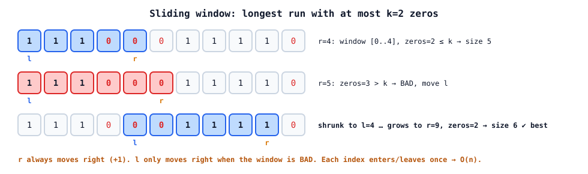

## G1. Max Vacation Days / Max Consecutive Ones III — LC 1004 ★★★
[LeetCode 1004](https://leetcode.com/problems/max-consecutive-ones-iii/) · Infosys wording: *N days, 1 = obligation, 0 = free. Cancel at most K obligations to get the longest free stretch.* That's the same as the longest window with **at most K bad days**.

```python
# G1 window
from typing import List

class Solution:
    def longestOnes(self, nums: List[int], k: int) -> int:
        l = 0
        bad = 0                             # zeros inside the window
        best = 0
        for r in range(len(nums)):
            if nums[r] == 0:
                bad += 1
            while bad > k:                  # too many to flip → shrink
                if nums[l] == 0:
                    bad -= 1
                l += 1
            best = max(best, r - l + 1)
        return best
```

For the vacation wording, count `nums[r] == 1` as bad instead.

**Dry run** `[1,1,1,0,0,0,1,1,1,1,0]`, `k=2` → **6**:

```text
r=0..2  window 111            bad 0  best 3
r=3,4   1110 0                bad 2  best 5
r=5     bad 3 > 2 → shrink l to 4      window [4..5]
r=6..9  0 0 1111 grows        bad 2  best 6   (indices 4..9)
r=10    bad 3 → l to 5        size 6  best 6 ✔
```

---

## G2. Subarray Product Less Than K — LC 713 ★★ (and "at least K")
[LeetCode 713](https://leetcode.com/problems/subarray-product-less-than-k/) · Positive numbers only. Every `r` adds `r - l + 1` new subarrays (all of them end at `r`).
**At least K** = `n(n+1)/2 - (count < K)`.

```python
# G2 product
from typing import List

class Solution:
    def numSubarrayProductLessThanK(self, nums: List[int], k: int) -> int:
        if k <= 1:
            return 0
        prod = 1
        l = 0
        count = 0
        for r in range(len(nums)):
            prod *= nums[r]
            while prod >= k:                # too big → shrink
                prod //= nums[l]
                l += 1
            count += r - l + 1              # subarrays ending at r
        return count

    def atLeastK(self, nums: List[int], k: int) -> int:
        n = len(nums)
        return n * (n + 1) // 2 - self.numSubarrayProductLessThanK(nums, k)
```

**Dry run** `[10,5,2,6]`, `k=100` → **8**:

```text
r  prod        l  add  count
0  10          0  1    1
1  50          0  2    3
2  100→/10=10  1  2    5     (shrink: drop 10)
3  60          1  3    8 ✔
```

---

## G3. Longest Substring Without Repeating Characters — LC 3 ★★
[LeetCode 3](https://leetcode.com/problems/longest-substring-without-repeating-characters/) · Store the last index of each char. On a repeat **inside** the window, jump `l` past it.

```python
# G3 substring
class Solution:
    def lengthOfLongestSubstring(self, s: str) -> int:
        last = {}                           # char -> last index seen
        l = 0
        best = 0
        for r, ch in enumerate(s):
            if ch in last and last[ch] >= l:
                l = last[ch] + 1            # jump past the repeat
            last[ch] = r
            best = max(best, r - l + 1)
        return best
```

**Dry run** `"abcabcbb"`: windows `abc`(3), `bca`, `cab`, `abc`, `cb`, `b` → **3** ✔

---

## G4. Subarray Sum Equals K (LC 560) / Divisible by K (LC 974) ★★
[LC 560](https://leetcode.com/problems/subarray-sum-equals-k/) · [LC 974](https://leetcode.com/problems/subarray-sums-divisible-by-k/) · Works with **negative numbers**, which the sliding window can't handle.
**Idea:** `sum(i..j) = prefix[j] - prefix[i-1]`. While scanning, count how many earlier prefixes equal `prefix - k`.

```python
# G4 sumk
from typing import List

class Solution:
    def subarraySum(self, nums: List[int], k: int) -> int:
        freq = {0: 1}                       # empty prefix seen once
        prefix = 0
        count = 0
        for x in nums:
            prefix += x
            count += freq.get(prefix - k, 0)        # earlier prefixes that make sum k
            freq[prefix] = freq.get(prefix, 0) + 1
        return count

    def subarraysDivByK(self, nums: List[int], k: int) -> int:
        freq = {0: 1}
        prefix = 0
        count = 0
        for x in nums:
            prefix = (prefix + x) % k               # same remainder → divisible gap
            count += freq.get(prefix, 0)
            freq[prefix] = freq.get(prefix, 0) + 1
        return count
```

**Dry run** `[1,2,3]`, `k=3`:

```text
x  prefix  need = prefix-3  found  count  freq
1  1       -2               0      0      {0:1, 1:1}
2  3        0               1      1      {0:1, 1:1, 3:1}   ← [1,2]
3  6        3               1      2      ✔                 ← [3]
```

---

## G5. Frog Jump with K steps — jump-cost DP ★★
[GFG Minimal Cost](https://www.geeksforgeeks.org/problems/minimal-cost/1) · K = 2 version: [GFG Geek Jump](https://www.geeksforgeeks.org/problems/geek-jump/1) · The frog jumps 1..k stones ahead. A jump costs `|h[i] - h[j]|`. Find the min cost to reach the last stone.
This is the "jump-cost DP" from the Sep 2026 report, and the "frog jump" from your Reddit paste.

```python
# G5 frog
from typing import List

class Solution:
    def frogJump(self, heights: List[int], k: int) -> int:
        n = len(heights)
        memo = {}

        def dfs(i):
            if i == n - 1:
                return 0                    # already on the last stone
            if i in memo:
                return memo[i]

            res = float('inf')
            # Choice: jump 1..k stones
            for j in range(1, k + 1):
                if i + j < n:
                    res = min(res, abs(heights[i] - heights[i + j]) + dfs(i + j))

            memo[i] = res
            return res

        return dfs(0)
```

**Dry run** `heights=[10,20,30,10]`, `k=2` → **20** (0 → 1 → 3: |10-20| + |20-10|):

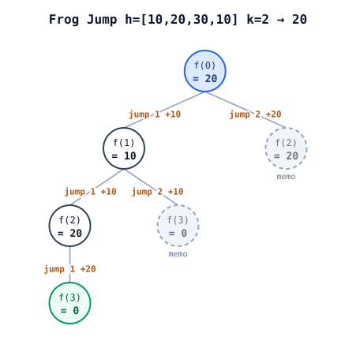

---

## G6. Monster Defeat — greedy sort ★★
You start with experience `exp`. Monster `i` needs `power[i]`, and beating it adds `bonus[i]`. What's the max number of monsters beaten?
**Greedy:** fight the weakest first. Bonuses only ever increase `exp`, so the weakest is never a wrong choice.

```python
# G6 monster
from typing import List

class Solution:
    def maxMonsters(self, exp: int, power: List[int], bonus: List[int]) -> int:
        count = 0
        for p, b in sorted(zip(power, bonus)):      # weakest first
            if exp < p:
                break                               # can't beat this or any stronger one
            exp += b
            count += 1
        return count
```

**Dry run** `exp=3`, `power=[1,4,8]`, `bonus=[2,3,1]`: 3≥1 → exp 5; 5≥4 → exp 8; 8≥8 → exp 9. **3** monsters ✔

---

## G7. Remove Digit to Maximize (LC 2259) and Largest Number (LC 179) ★★

[LC 2259](https://leetcode.com/problems/remove-digit-from-number-to-maximize-result/) · Remove the **first** `digit` whose next char is bigger (the number grows right there). If there's none, remove the **last** occurrence.

```python
# G7 remove
class Solution:
    def removeDigit(self, number: str, digit: str) -> str:
        for i in range(len(number) - 1):
            if number[i] == digit and number[i + 1] > number[i]:
                return number[:i] + number[i + 1:]     # earliest gain
        i = number.rfind(digit)                        # else: last one hurts least
        return number[:i] + number[i + 1:]
```

[LC 179](https://leetcode.com/problems/largest-number/) · **Twisted sort:** `a` goes before `b` if `a + b > b + a` as strings.

```python
# G7 largest
from functools import cmp_to_key
from typing import List

class Solution:
    def largestNumber(self, nums: List[int]) -> str:
        strs = [str(x) for x in nums]

        def cmp(a, b):
            if a + b > b + a:
                return -1                   # a first
            if a + b < b + a:
                return 1
            return 0

        strs.sort(key=cmp_to_key(cmp))
        res = ''.join(strs)
        return '0' if res[0] == '0' else res     # [0,0] → "0"
```

**Dry run** `[3,30,34,5,9]`: `"3"+"30"="330" > "303"`, so 3 goes before 30. The sorted order is `9,5,34,3,30` → **"9534330"** ✔

---

## G8. LIS with a condition (bitwise) ★★
SP lists from 2023 to 2026 keep showing "longest subsequence where adjacent elements satisfy an AND/OR/XOR condition". It's **your LIS top-down with a different `if`**. Only the `ok(a, b)` line changes:

```python
# G8 liscond
from typing import List

class Solution:
    def longestWithCondition(self, nums: List[int]) -> int:
        n = len(nums)
        memo = {}

        def ok(a, b):
            return (a & b) != 0             # ← change this line to the exam's condition

        def dfs(i):                         # longest valid chain starting at i
            if i in memo:
                return memo[i]
            best = 1
            for j in range(i + 1, n):
                if ok(nums[i], nums[j]):
                    best = max(best, 1 + dfs(j))
            memo[i] = best
            return best

        return max(dfs(i) for i in range(n))
```

`O(n²)` is fine for n ≤ 2000. For bigger n you'd need a bit-trick and it becomes a Hard, so take the partial marks.

---

## G9. Next Greater Element — monotonic stack ★
[GFG Next Greater Element](https://www.geeksforgeeks.org/problems/next-larger-element-1587115620/1) · Circular version: [LC 503](https://leetcode.com/problems/next-greater-element-ii/)
The stack holds indices **still waiting** for a bigger number. A new bigger `x` answers all of them.

```python
# G9 nge
from typing import List

class Solution:
    def nextGreater(self, nums: List[int]) -> List[int]:
        res = [-1] * len(nums)
        stack = []                          # indices waiting for a greater value
        for i, x in enumerate(nums):
            while stack and nums[stack[-1]] < x:
                res[stack.pop()] = x        # x is their next greater
            stack.append(i)
        return res
```

For the circular version, loop `i in range(2 * n)`, use `x = nums[i % n]`, and only push when `i < n`.

**Dry run** `[4,5,2,25]`:

```text
i=0 x=4   stack [0]
i=1 x=5   pop 0 → res[0]=5        stack [1]
i=2 x=2   stack [1,2]
i=3 x=25  pop 2 → 25, pop 1 → 25  stack [3]
res = [5,25,25,-1] ✔
```

---

## G10. Cheapest Flights Within K Stops — BFS by levels ★★
[LeetCode 787](https://leetcode.com/problems/cheapest-flights-within-k-stops/) · This is the "shortest path with an extra constraint" type.
**BFS idea:** one BFS level = one more flight. Run at most `k+1` levels. Push a neighbour only if this route makes it **cheaper** than before.

```python
# G10 flights
from collections import defaultdict, deque
from typing import List

class Solution:
    def findCheapestPrice(self, n: int, flights: List[List[int]], src: int, dst: int, k: int) -> int:
        adj = defaultdict(list)
        for u, v, w in flights:
            adj[u].append((v, w))

        dist = [float('inf')] * n
        dist[src] = 0
        q = deque([(src, 0)])               # (city, cost so far)
        level = 0
        while q and level <= k:             # k stops = k+1 flights
            for _ in range(len(q)):
                u, cost = q.popleft()
                for v, w in adj[u]:
                    if cost + w < dist[v]:  # cheaper way found → explore it
                        dist[v] = cost + w
                        q.append((v, cost + w))
            level += 1
        return -1 if dist[dst] == float('inf') else dist[dst]
```

**Dry run** `0→1 (100), 1→2 (100), 2→0 (100), 1→3 (600), 2→3 (200)`, `src=0, dst=3, k=1`:

```text
level 0: from 0       → 1 @100
level 1: from 1 @100  → 2 @200, 3 @700
stop (k=1 → only 2 levels). 0→1→2→3 = 400 needs 2 stops, not allowed
answer 700 ✔
```

---

## G11. Number of Provinces — BFS components ★
[LeetCode 547](https://leetcode.com/problems/number-of-provinces/) · The "DSU-flavored" question can be done with BFS. Count how many times you start a new BFS.

```python
# G11 provinces
from collections import deque
from typing import List

class Solution:
    def findCircleNum(self, isConnected: List[List[int]]) -> int:
        n = len(isConnected)
        seen = [False] * n
        count = 0
        for i in range(n):
            if not seen[i]:
                count += 1                  # new group found
                seen[i] = True
                q = deque([i])
                while q:
                    u = q.popleft()
                    for v in range(n):
                        if isConnected[u][v] == 1 and not seen[v]:
                            seen[v] = True
                            q.append(v)
        return count
```

**Dry run** `[[1,1,0],[1,1,0],[0,0,1]]`: city 0 starts BFS {0,1}, city 2 starts BFS {2} → **2** ✔

---

## G12. Longest Palindromic Substring — expand around centre ★
[LeetCode 5](https://leetcode.com/problems/longest-palindromic-substring/) · Every palindrome has a centre: one char (odd length) or a gap between two chars (even length). Expand while the ends match.

```python
# G12 palin
class Solution:
    def longestPalindrome(self, s: str) -> str:
        res = ""
        for c in range(len(s)):
            for l, r in ((c, c), (c, c + 1)):       # odd centre, even centre
                while l >= 0 and r < len(s) and s[l] == s[r]:
                    l -= 1
                    r += 1
                if r - l - 1 > len(res):
                    res = s[l + 1:r]                # last valid window
        return res
```

**Dry run** `"babad"`: the centre at `a`(1) expands to `bab` → **"bab"** (`"aba"` is also valid).

---

## G13. Pair Sum in a Sorted Rotated Array — two pointers ★★
May 2026 OA. [GFG Pair in a sorted rotated array](https://www.geeksforgeeks.org/dsa/given-a-sorted-and-rotated-array-find-if-there-is-a-pair-with-a-given-sum/)
Find the **pivot** (the largest element). The smallest is just after it. Then run normal two pointers, moving with `% n`.

```python
# G13 rotated
from typing import List

class Solution:
    def pairInRotated(self, arr: List[int], target: int) -> bool:
        n = len(arr)
        pivot = n - 1                       # index of the largest value
        for i in range(n - 1):
            if arr[i] > arr[i + 1]:
                pivot = i
                break
        l = (pivot + 1) % n                 # smallest
        r = pivot                           # largest
        while l != r:
            s = arr[l] + arr[r]
            if s == target:
                return True
            if s < target:
                l = (l + 1) % n             # need bigger
            else:
                r = (r - 1 + n) % n         # need smaller
        return False
```

**Dry run** `[11,15,6,8,9,10]`, `target=16`: pivot = index 1 (15), `l` = 6, `r` = 15.

```text
6+15=21 > 16 → r→11    6+11=17 > 16 → r→10    6+10=16 ✔ True
```

---

## Final verdict: is this enough?

**Yes, for a 2/4 target.** The plan now covers every pattern that appears in the 2021–2026 reports I could find: top-down DP (1D, 2D, take/skip, `dfs(i, state)`), greedy and sorting, sliding window, prefix-sum hashmap, monotonic stack, binary search on the answer, and BFS.

**What no list can do:** Infosys writes **new story-based problems** for most drives. The Nov 2026 Reddit set (Cards, Flags, Lift, Weeks...) repeated across cities in the **same week**, so if your slot is in the same cycle, Part 2 is the highest-value revision. Otherwise you'll pass on **recognising the pattern**, not on having seen the exact question.

**Last-day order (stop when time runs out):**
1. Part 2: P1 Cards, P2 Flags, P3 Lift, P8 Weeks, P9 Stakes. Type them from a blank file.
2. Part 1: §1 Coin Change, §4 LCS, §6 Partition/Knapsack. This is the DP core.
3. Part 3: G1 window, G4 prefix-sum, G5 frog jump.
4. Read the cue tables only (Part 1 end + below). Don't learn new problems the night before.

| Story says... | It's really... | Go to |
|---|---|---|
| "at most K bad / cancel K / flip K" + longest | sliding window | G1 |
| count subarrays with sum = K (negatives ok) | prefix-sum hashmap | G4 |
| "jump up to k steps, cost = difference" | `dfs(i)` loop over k | G5 |
| "defeat / unlock if power ≤ X, gain bonus" | sort ascending, greedy | G6 |
| "arrange numbers to form the largest" | custom comparator sort | G7 |
| "next bigger to the right" | monotonic stack | G9 |
| "cheapest route with at most K stops" | BFS by levels | G10 |
| "groups / connected / friends circles" | BFS components | G11 |
